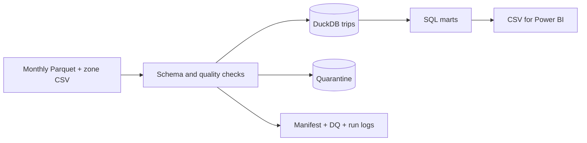

# NYC Taxi ETL — Monthly Data Warehouse

Pipeline ETL cho dữ liệu NYC Yellow Taxi: nạp từng tháng từ Parquet, kiểm tra chất lượng, cách ly dữ liệu vi phạm, lưu kho SQL và xuất bảng tổng hợp cho Power BI.

## Dashboard Power BI Project

Dashboard PBIP có bốn trang: **Tổng quan**, **Chất lượng dữ liệu**, **Nhịp nhu cầu** và **Hiệu quả khu vực**. Đã mở/refresh và đối soát DAX trên Power BI Desktop thật. Hai trang phân tích sâu hỗ trợ chọn thứ/giờ và Borough để lọc các chỉ số liên quan.

Mở `dashboard/TaxiAnalytics.pbip`. Xem [hướng dẫn Power BI](docs/power-bi.md) để đặt DataRoot, refresh và hiểu phạm vi bộ lọc.

Ảnh chụp dashboard được giữ trong bản local. Repository cung cấp PBIP/PBIR/TMDL đầy đủ để mở và chỉnh sửa bằng Power BI Desktop.

## Kết quả đã kiểm chứng trên dữ liệu thật

| Chỉ tiêu | Q1/2025 |
|---|---:|
| Dòng nguồn | 11.198.026 |
| Dòng vào fact | 11.168.445 |
| Dòng cách ly để xem xét | 29.581 |
| Unit/integration tests trên fixture | 7/7 đạt |

Đã chạy lại toàn bộ ba tháng: cả trường hợp skip theo checksum và ép nạp lại. Số dòng và content fingerprint giữ nguyên; số chuyến trong cả ba mart khớp fact. Đây là kết quả local trên bộ file đã tải, không phải chứng nhận dữ liệu nguồn hoàn toàn chính xác. Xem [validation](docs/VALIDATION.md).

## Bài toán

Chuẩn bị dữ liệu có thể kiểm tra để theo dõi số chuyến, thời gian di chuyển, khu vực đón khách và tổng số tiền được ghi nhận. Bộ dữ liệu local dùng quý I/2025. Mỗi dòng đầu vào là một bản ghi chuyến đi; không có mã chuyến duy nhất do nguồn cung cấp.



## Chạy nhanh

Python 3.12; chạy lệnh từ thư mục chứa README này.

```powershell
python -m venv .venv
.venv\Scripts\python -m pip install -r requirements-dev.txt
.venv\Scripts\python -m pytest -q
.venv\Scripts\python -m taxi_etl --raw-dir "Y:\Data Analyst\Data Work\Project Analyst\Taxi"
```

Không có dữ liệu local? Tải từ nguồn chính thức rồi chạy pipeline:

```powershell
python scripts/download.py --month 2025-01 --month 2025-02 --month 2025-03
python -m taxi_etl --raw-dir data/raw
```

Chạy một tháng hoặc nạp lại có chủ đích:

```powershell
python -m taxi_etl --raw-dir data/raw --month 2025-01
python -m taxi_etl --raw-dir data/raw --month 2025-01 --force
```

## Kết quả đầu ra

- `artifacts/taxi.duckdb`: fact trips, quarantine, dim_zone, manifest và kiểm tra chất lượng.
- `artifacts/exports/`: mart_daily, mart_pickup_zone, mart_hourly, dim_zone, dq_missing, dq_checks, etl_manifest dạng CSV.
- `run-<UUID>.json` và `.log`: trạng thái từng tháng, số dòng, thời gian và lỗi khi chạy.
- `docs/VALIDATION.md`: bằng chứng chạy trên dữ liệu thật; `docs/power-bi.md`: cách dựng báo cáo.
- [Data dictionary](docs/data-dictionary.md): đầy đủ 20 cột và các trường bổ sung.

Kiểm chứng lại dữ liệu thật sau lần ETL đầu tiên (lệnh này thực sự thay thế lại mọi partition để so sánh content fingerprint):

```powershell
python -m scripts.validate_real --raw-dir "Y:\Data Analyst\Data Work\Project Analyst\Taxi"
```

Đóng gói code và bằng chứng nhỏ để lưu trữ hoặc đưa lên GitHub:

```powershell
python scripts/package_project.py
```

ZIP không chứa database, dữ liệu gốc và thư mục artifacts. Để xem kết quả local đã chạy, dùng trực tiếp thư mục artifacts bên cạnh README. Khi đưa lên GitHub, giữ nguyên cấu trúc project và file ẩn `.github` / `.gitignore`.

## Các quyết định kỹ thuật

**Incremental theo file tháng.** Hash SHA-256 của Parquet, lookup và phiên bản policy quyết định skip hay thay thế partition. Đây là file-based incremental load, không phải CDC theo từng giao dịch.

**Idempotent và atomic theo tháng.** Một transaction xóa/thay thế đúng `source_month`; nếu lỗi, rollback tháng đó. Các tháng đã commit trước đó vẫn được giữ. Đổi lookup sẽ làm các tháng được chọn cần nạp lại; nên chạy toàn bộ khi cập nhật lookup.

**Khóa kỹ thuật.** `(source_month, source_row_number)` nhận diện dòng vật lý trong file nguồn. Khóa không đại diện ID chuyến thực tế; thay file có thể đổi row number. Không xóa những chuyến trông giống nhau khi chưa có bằng chứng nghiệp vụ.

**Quarantine.** Cách ly dòng thiếu timestamp, thời lượng <= 0, ngày đón ngoài tháng của file, hoặc mã khu vực không có trong lookup. Đây là policy của project; dữ liệu ngoài tháng có thể là báo cáo trễ, nên được giữ trong quarantine để xem xét chứ không bị mất.

**Soft flags.** Giữ lại số tiền âm/0, quãng đường 0, missing số khách; gắn cờ khoảng cách >200 miles hoặc <0 và số tiền >1.000 USD. Ngưỡng là heuristic có phiên bản, không phải kết luận gian lận. Missing không được điền 0. DQ missing ghi đủ 20 cột với cả count và percentage.

**Schema drift.** Đổi tập cột nguồn làm pipeline thất bại rõ ràng. Kiểu dữ liệu được DuckDB kiểm tra khi nạp vào schema đích; chưa có cơ chế tự động migration.

**Đối soát.** Raw = accepted + quarantine. Marts chỉ lấy accepted; các dòng có soft flag vẫn được tính. `recorded_total_amount` giữ dấu âm và outlier, thể hiện tổng tiền ghi trong dữ liệu, không phải doanh thu thuần đã xác minh hay lợi nhuận.

**Database.** DuckDB phục vụ portfolio chạy local, SQL và Parquet hiệu quả. Dashboard PBIP đọc CSV tổng hợp và có semantic model TMDL. Bản này chưa triển khai PostgreSQL, Airflow, lịch chạy production hay cảnh báo ngoài hệ thống.

## Nguồn và tái lập

- [NYC TLC trip records](https://www.nyc.gov/site/tlc/about/tlc-trip-record-data.page)
- [Yellow Taxi data dictionary](https://www.nyc.gov/assets/tlc/downloads/pdf/data_dictionary_trip_records_yellow.pdf)
- [Taxi Zone Lookup](https://d37ci6vzurychx.cloudfront.net/misc/taxi_zone_lookup.csv)

Không commit dữ liệu lớn hoặc database. Repo có tests dùng dữ liệu giả lập được ghi rõ và CI chạy tests; không tự tải 11 triệu dòng trong CI. Xem manifest để biết checksum của lần chạy local. Source có thể được cập nhật sau đó; checksum khác cần đánh giá lại kết quả.

## Phỏng vấn

Hãy trình bày bài toán, policy quarantine/soft flags, transaction theo partition, checksum để skip, và bằng chứng chạy lại. Không mô tả bản local này là hệ thống production hoặc CDC. Các giới hạn và trade-off nằm trong [tài liệu thiết kế](docs/design.md).
