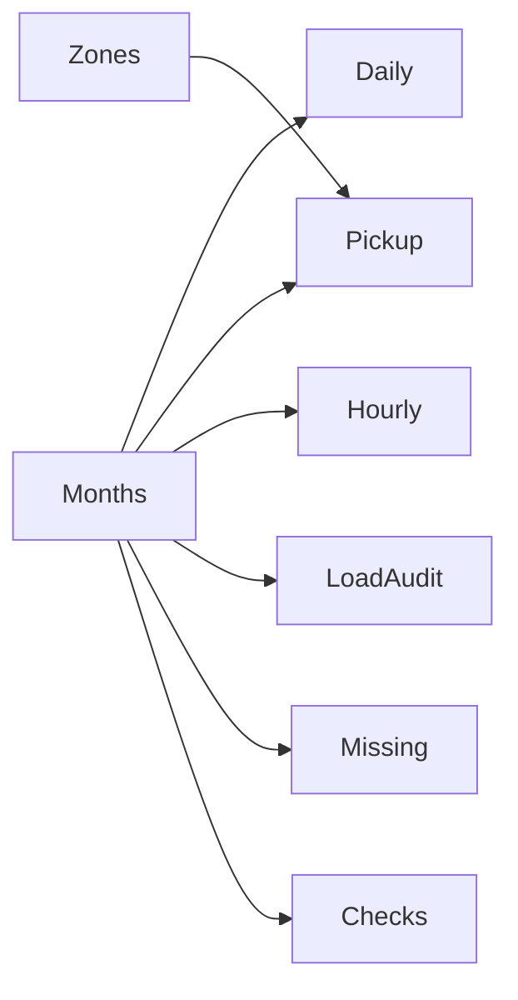

# Power BI dashboard — NYC Taxi Analytics

## Mở project

Mở `dashboard/TaxiAnalytics.pbip` bằng Power BI Desktop. Giữ nguyên hai thư mục `TaxiAnalytics.Report` và `TaxiAnalytics.SemanticModel` nằm cạnh file PBIP.

Bản local được tạo và mở kiểm chứng bằng Power BI Desktop 2.142.1277.0 (2025). Đã bật Preview features → Store reports using enhanced metadata format (PBIR). PBIP và TMDL cũng cần được bật trên các phiên bản Desktop cũ. Report dùng PBIR document version 2.0.0 và visual schema 1.0.0 để tương thích bản đã cài. Không cần publish lên Service.

## Bốn trang

**Tổng quan:** số chuyến accepted, tổng tiền ghi nhận (USD), tiền/chuyến, tỷ lệ chuyến gắn cờ; xu hướng theo ngày; phân bố theo giờ đón; số chuyến theo Borough và Zone. Biểu đồ Zone có thanh cuộn; tooltip giúp đọc tên bị rút gọn.

**Chất lượng dữ liệu:** số dòng raw, accepted, quarantine, tỷ lệ cách ly; cách ly theo tháng; missing theo cột và bảng kiểm tra. Các kiểm tra có thể chồng lấp. Measure trả BLANK ở grand total của bảng kiểm tra/missing để tránh cộng sai ý nghĩa.

**Nhịp nhu cầu:** số chuyến bình quân/ngày, số ngày có dữ liệu, tỷ trọng chuyến cuối tuần và tiền/chuyến; biểu đồ bình quân theo thứ; đường nhu cầu theo giờ; ma trận thứ × giờ. Bấm một cột thứ hoặc điểm giờ để lọc các chỉ số và chi tiết liên quan. Tỷ trọng cuối tuần luôn giữ phạm vi tháng đang chọn, không đổi theo lần bấm thứ/giờ.

**Hiệu quả khu vực:** số chuyến, số khu vực có chuyến, tiền/chuyến và tỷ lệ gắn cờ; so sánh tiền ghi nhận và tiền/chuyến giữa các Borough; bảng vùng đón có lượng chuyến, tỷ trọng, tiền ghi nhận, tiền/chuyến và tỷ lệ gắn cờ. Bấm Borough để lọc bảng và thẻ chỉ số; bấm lại để bỏ chọn. Bảng mặc định xếp theo lượng chuyến giảm dần. EWR, N/A và Unknown được giữ như phân loại nguồn; không diễn giải như các Borough hành chính của NYC.

Mỗi trang có bộ lọc tháng riêng, mặc định All; không đồng bộ giữa các trang. Tháng lọc các bảng qua Months. Hai trang gốc tắt tương tác chéo vì có nhiều grain khác nhau. Hai trang mới bật lọc giữa các biểu đồ cùng fact. Chưa có drill-through.

## Refresh

1. Chạy ETL để cập nhật CSV trong `artifacts/exports`.
2. Mở PBIP và bấm Refresh trong Desktop.
3. Nếu chuyển thư mục, mở Transform data → Edit parameters, đặt `DataRoot` thành đường dẫn tuyệt đối tới `artifacts/exports` mới, rồi Close & Apply / Refresh.
4. Save để giữ cache và các chỉnh sửa local.

DataRoot của bản bàn giao:

```text
Y:\Data Analyst\Data Work\Project Analyst\Taxi\nyc-taxi-etl\artifacts\exports
```

Months đọc từ manifest, tự nhận tháng mới khi ETL và Power BI refresh. Power BI đọc CSV, không đọc trực tiếp DuckDB.

## Semantic model

8 bảng import: Daily, Pickup, Hourly, Zones, Months, LoadAudit, Missing, Checks. Quan hệ single direction: Months → 6 bảng fact/audit; Zones → Pickup. Không nối các fact trực tiếp.



| Measure | Định nghĩa |
|---|---|
| Số chuyến | SUM(Daily[trip_count]), chỉ accepted |
| Tổng tiền ghi nhận | SUM(Daily[recorded_total_amount]), USD, giữ dấu âm và outlier |
| Tiền / chuyến | Tổng tiền ghi nhận / Số chuyến |
| Tỷ lệ gắn cờ | SUM(flagged_trip_count) / SUM(trip_count), trên accepted |
| Tỷ lệ cách ly | SUM(quarantined_rows) / SUM(raw_rows), trên raw |
| Tỷ lệ thiếu | SUM(missing_count) / SUM(raw_rows), riêng từng cột trong các tháng được chọn |
| Chuyến / ngày theo thời điểm | Số chuyến trong các thứ/giờ đang chọn / số ngày có dữ liệu cùng thứ trong Daily, cùng phạm vi tháng |
| Tỷ trọng chuyến cuối tuần | Chuyến thứ 7 + chủ nhật / toàn bộ chuyến trong tháng chọn; bỏ lọc thứ/giờ |
| Tiền / chuyến khu vực | SUM(Pickup[recorded_total_amount]) / SUM(Pickup[trip_count]); không trung bình các tỷ lệ vùng |
| Tỷ trọng chuyến khu vực | Chuyến của dòng vùng / tổng chuyến trong phạm vi chọn bên ngoài bảng; ALLSELECTED(Zones) bỏ context dòng và giữ bộ lọc Borough |
| Số khu vực có chuyến | Đếm location_id có tổng trip_count > 0 trong phạm vi chọn |

`Số dòng theo kiểm tra` ghi trên raw; `Chuyến gắn cờ` ghi trên accepted, nên không bắt buộc bằng nhau. Missing nhiều tháng được tính có trọng số số dòng; không trung bình các tỷ lệ tháng.

Không coi tổng tiền là lợi nhuận/doanh thu thuần đã kiểm toán. Soft flags vẫn được tính. Giờ giữ thời gian nguồn, chưa chuẩn hóa timezone/DST. Không gộp median ngày thành median quý.

Q1/2025 có đủ 90 ngày trong mart Daily. Nếu kỳ tương lai thiếu hẳn một ngày, mẫu số bình quân chỉ tính ngày có dữ liệu; không tự xem ngày thiếu là nhu cầu bằng 0. Nhu cầu ở đây là số chuyến thực tế ghi nhận, không bao gồm nhu cầu chưa được phục vụ. Chưa có dữ liệu chi phí, giờ hoạt động xe hoặc tài xế để kết luận lợi nhuận hay năng suất tài xế. Khu vực ít chuyến có thể có tỷ lệ kém ổn định; xem lượng chuyến cùng với tiền/chuyến và gắn cờ.

## Kiểm tra và source control

- [DAX từng tháng từ engine thật](evidence/dashboard-dax.json)
- [Binding, layout và đối soát CSV](evidence/dashboard-static.json)
- [DAX phân tích sâu](evidence/dashboard-advanced-dax.json) / [DAX tỷ trọng vùng](evidence/dashboard-zone-share-dax.json)
- [Đối soát 504 ô tháng–thứ–giờ và tỷ trọng vùng](evidence/dashboard-advanced-validation.json)
- [Kiểm thử Desktop](DASHBOARD-VALIDATION.md)

TMDL trong `TaxiAnalytics.SemanticModel/definition` là định nghĩa PBIP sử dụng. `model.bim` là bản trung gian của scaffold và có thể không phản ánh các tùy chỉnh mới trong Desktop.

`scripts/build_dashboard.py` chỉ dành cho scaffold/tái tạo có chủ đích. Không chạy để refresh; dùng --overwrite sẽ ghi lại report. `scripts/validate_dashboard.py` kiểm tra binding/layout và đối soát CSV; render vẫn cần Desktop.

`scripts/extend_dashboard.py` tạo lại riêng hai trang phân tích sâu, yêu cầu semantic model đã có 27 measures và cột Hourly[Thứ] như bản bàn giao; không chạy nếu muốn giữ các sửa đổi Desktop trên hai trang này. `scripts/validate_advanced_dashboard.py` đối soát kết quả DAX đã lưu với CSV; sau khi dữ liệu thay đổi cần chạy lại các query trong evidence bằng engine thật trước khi kiểm chứng.

Commit PBIP/PBIR/PBISM, TMDL, report JSON, scripts và tài liệu. Không commit `.pbi`, `.abf`, database lớn hoặc raw Parquet. ZIP code đã loại `.pbi`; khi clone, chạy ETL, đặt DataRoot và Refresh.

Tham khảo định dạng: [Microsoft PBIP report folder](https://learn.microsoft.com/power-bi/developer/projects/projects-report).
